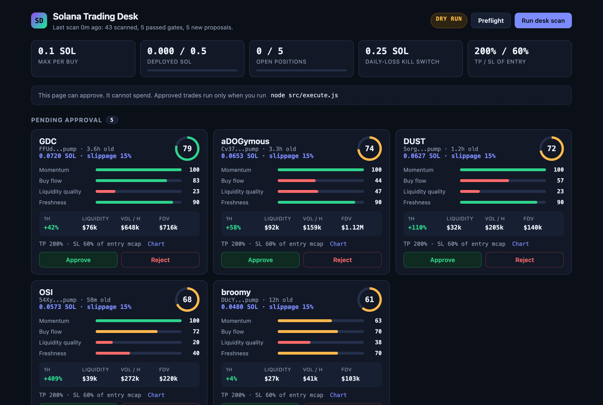
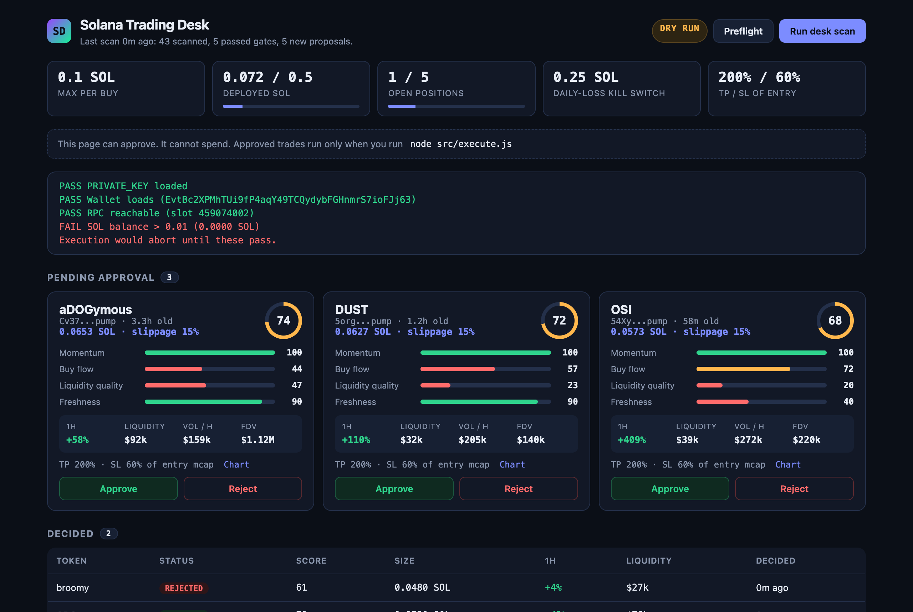
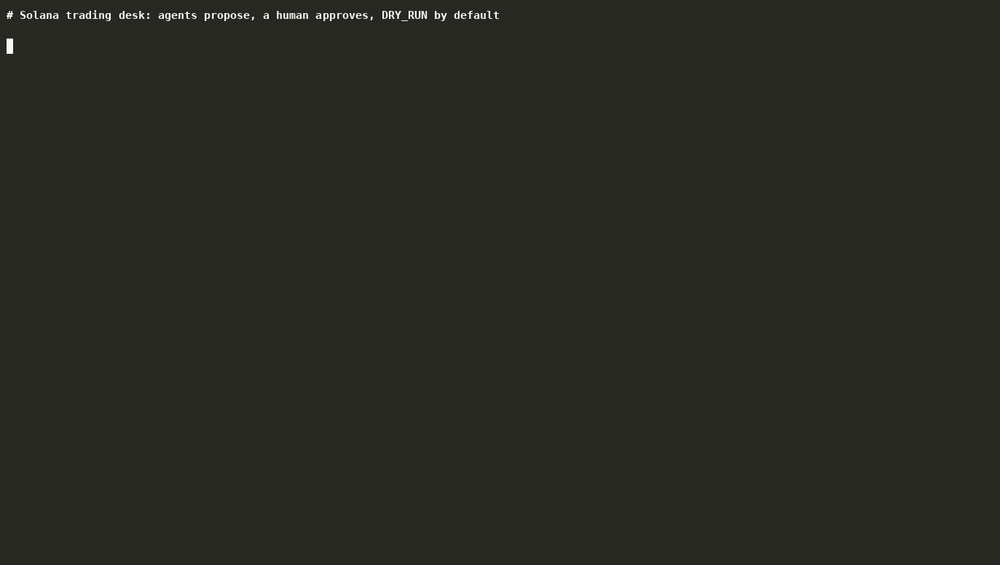
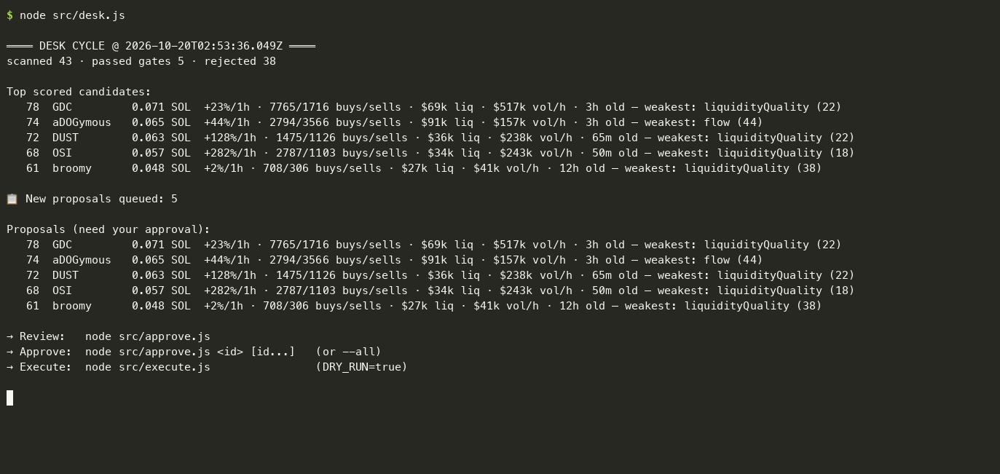
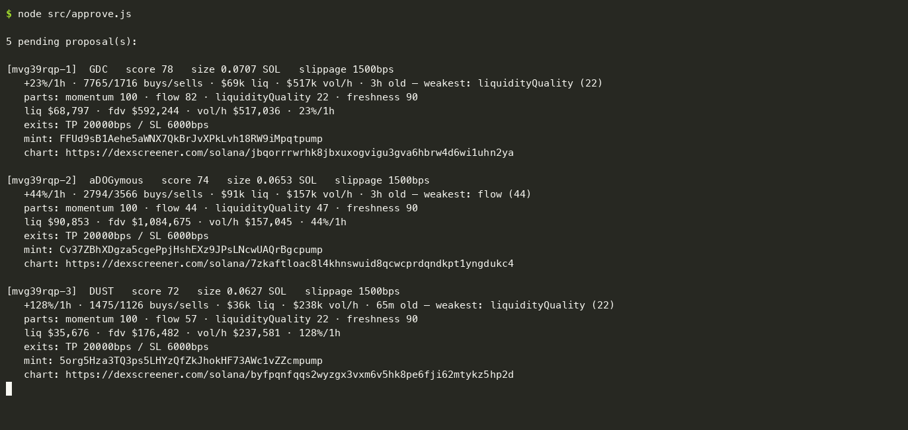
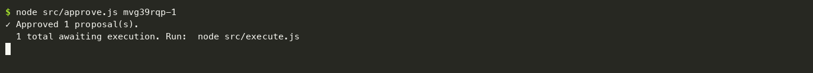
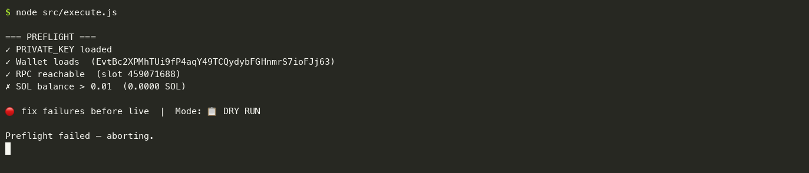

# Solana Trading Desk (propose-only)

A multi-agent Solana trading desk that does the boring 95% on its own and stops
at the 5% that spends your money. Agents scan the market, rank setups and size
positions. **You approve. TradeRouter executes.** There is no "Always Allow."

This is the honest version of the "350 bots run my desk" story: 5 focused
agents and a human, a real approval gate, and hard risk limits in code instead
of autonomy theater.


*Real run from a fresh clone. The tokens are live scanner output, not
recommendations. The wallet is a brand-new throwaway with 0 SOL, so preflight
refuses to trade.*

## Quick start

Requires Node 20+.

```bash
git clone https://github.com/metaver5o/solana-trading-desk
cd solana-trading-desk
npm install
cp .env.example .env    # limits and filters; PRIVATE_KEY is only needed to execute
npm run web             # open http://127.0.0.1:4777 and click "Run desk scan"
```

Nothing above touches a wallet or sends an order. Scanning, scoring, reviewing
and approving all work without a key.

## The desk

| Agent | File | Job |
|-------|------|-----|
| Scanner | `src/agents/scanner.js` | Pull the candidate universe (Dexscreener, free) and apply hard liquidity, age and volume gates |
| Setup analyst | `src/agents/setup.js` | Score 0 to 100 on a transparent momentum, buy-flow, liquidity-quality and freshness heuristic |
| Risk manager | `src/agents/risk.js` | Decide *if* and *how much*: enforce portfolio caps and size by conviction within `MAX_BUY_SOL` |
| Head of desk | `src/agents/headofdesk.js` | Run the cycle and escalate only what clears risk to the proposal queue |
| Executor | `src/execution/traderouter.js` | The only code that spends: DRY_RUN gate, kill switch, server-signature check |

The human sits between the head of desk and the executor. Proposals wait in
`data/proposals.json` (plain JSON you can read or edit) until you approve or
reject them.

## Web UI

```bash
npm run web      # http://127.0.0.1:4777
```

A local control room over the same code paths as the CLI:

- **Run desk scan**: the full scan, score and size cycle
- **Pending approval**: one card per proposal with the score, the breakdown per
  factor, 1h change, liquidity, volume per hour, FDV, take-profit and stop-loss,
  and a chart link
- **Approve / Reject**: marks intent only
- **Preflight**: wallet, RPC and balance checks, the same ones `execute.js` runs
- **Limits strip**: max per buy, deployed SOL and open positions against their
  caps, daily-loss kill switch, TP/SL
- **Decided**: history of approved, rejected and executed proposals

**It can approve. It cannot spend.** The server has no execute route. Approved
trades run only when you run `node src/execute.js` yourself.

How the page is locked down:

- Binds to `127.0.0.1` only and rejects requests for any other Host
- Every write needs a per-process token embedded in the page, so another
  website open in your browser can't approve trades through it
- No external scripts, fonts or CDNs: the page talks only to this server
- Port is configurable with `WEB_PORT`





## CLI

Everything the UI does is also a command:

| Command | npm script | What it does |
|---------|------------|--------------|
| `node src/desk.js` | `npm run desk` | Scan, rank and size, then write proposals. Read-only, no wallet. `--loop 15` re-scans every 15 minutes |
| `node src/approve.js` | `npm run queue` | Print the pending queue in full |
| `node src/approve.js <id> [id...]` | `npm run approve -- <id>` | Approve (intent only). `--all` approves every pending proposal, `--reject <id>` rejects |
| `node src/execute.js --preflight` | `npm run preflight` | Checks only, no trades |
| `node src/execute.js` | `npm run execute` | Execute approved buys, then place TP/SL limit orders |
| `node src/web.js` | `npm run web` | The web UI above |
| `node src/paper.js` | | Paper forward-test (see below) |

### What each step looks like



**1. `node src/desk.js`**: scan, gate, score and size. No wallet is touched.



**2. `node src/approve.js`**: the full queue, with the score breakdown, exits
and chart link for each proposal.



**3. `node src/approve.js <id>`**: marks intent only. Nothing is spent.



**4. `node src/execute.js`**: preflight runs before anything is signed. Here
the wallet is empty, so it aborts.



## Executing

`execute.js` is the only path that can spend, and it is gated twice:

1. **Preflight must pass**: `PRIVATE_KEY` loads, the RPC answers, and the
   wallet holds more than 0.01 SOL. Otherwise it aborts before doing anything.
2. **DRY_RUN** (on by default): with preflight passing, it walks the full
   execution path and submits nothing.

Going live is a deliberate, separate act: set `DRY_RUN=false` in `.env`. Use a
dedicated wallet funded only with what you're willing to lose.

## Paper forward-test

Before funding anything, test whether the score means anything:

```bash
node src/paper.js            # one round: open new signals, re-price, report
node src/paper.js mark       # re-price open paper positions only
node src/paper.js report     # print the scorecard
node src/paper.js --loop 15  # run a round every 15 minutes
```

Every paper result has `PAPER_FRICTION_BPS` (5% by default) subtracted for
slippage and fees, and open positions close at mark after `PAPER_EXPIRY_HOURS`.
The verdict is the "expectancy by score band" table: if expectancy rises with
the score and the top band is positive, the signal may have an edge worth
funding. If it's flat or negative, you found out for free.
`scripts/paper-cron.sh` runs one round from cron.

## Safety (in `src/execution/traderouter.js` and `src/agents/risk.js`)

- **DRY_RUN=true by default**: no accidental live trade on first run
- **Per-buy cap** `MAX_BUY_SOL`, enforced on the REST and WebSocket paths
- **Portfolio caps** `MAX_DEPLOYED_SOL` and `MAX_POSITIONS`
- **Daily-loss kill switch** `MAX_DAILY_LOSS_SOL`: halts all execution
- **Slippage bounds** 1% to 25%, and a 15-minute cooldown on tokens that
  can't be swapped
- **Server-signature verification** on every fill before signing
- **Human approval** between proposal and execution, in the CLI or the UI.
  That gate is the whole point.

## Configuration

All settings live in `.env` (copy `.env.example`). The main groups:

- **Wallet and RPC**: `PRIVATE_KEY` (only for execution), `RPC_URL`
- **Safety**: `DRY_RUN`, `MAX_BUY_SOL`, `BANKROLL_SOL`, `MAX_DEPLOYED_SOL`,
  `MAX_POSITIONS`, `MAX_DAILY_LOSS_SOL`, `DEFAULT_SLIPPAGE_BPS`
- **Scanner gates**: `MIN_LIQUIDITY_USD`, `MAX_FDV_USD`, `MIN_AGE_MINUTES`,
  `MAX_AGE_HOURS`, `MIN_VOL_H1_USD`
- **Exits**: `TP_BPS`, `SL_BPS` (basis points of entry market cap)
- **Paper test**: `PAPER_FRICTION_BPS`, `PAPER_EXPIRY_HOURS`
- **TradeRouter trust anchor**: `TRADEROUTER_SERVER_PUBKEY`,
  `TRADEROUTER_REQUIRE_SERVER_SIGNATURE`
- **Web UI**: `WEB_PORT` (default 4777)

`.env` is git-ignored. Never commit it, and never screen-record a terminal with
it loaded.

## Project layout

```
src/
  agents/          scanner, setup analyst, risk manager, head of desk
  data/            Dexscreener client
  execution/       TradeRouter client: safety gates, signing, preflight
  paper/           paper-trade ledger
  web/             the UI page (no build step)
  desk.js          propose cycle
  approve.js       approval CLI
  execute.js       the only entry point that can spend
  paper.js         forward-test runner
  web.js           local UI server
  proposals.js     the approval queue (data/proposals.json)
  config.js        settings and limits from .env
scripts/
  paper-cron.sh    one paper round, for cron
docs/              screenshots and demos used in this README
```

## Honest limits

- The scoring heuristic is a **starting rubric, not proven alpha.** It filters
  for liquid, trending, buy-pressured tokens. It does not predict price. Tune
  the weights in `setup.js` or swap in your own model; the rest of the desk
  doesn't change. Run the paper test before trusting it.
- Dexscreener's free data is rate-limited and can lag. For serious use, add a
  paid data feed and a paid RPC.
- Memecoin trading loses money by default. This tool makes the process
  disciplined and auditable. It does not make it profitable. Size accordingly.

## License

MIT. See [LICENSE](LICENSE).
